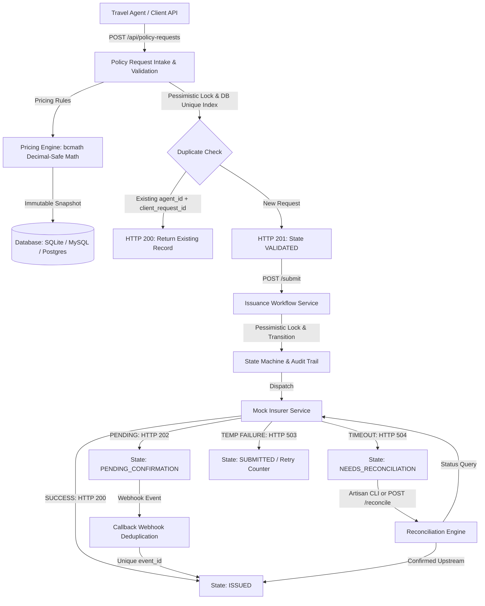

# PolicyFlow

### Fault-Tolerant Travel Insurance Issuance & Idempotent Reconciliation Engine
**Campus Placement | Software Engineering Practical Assessment**

[](https://php.net)
[](https://laravel.com)
[-emerald.svg)](tests/)
[](LICENSE)

PolicyFlow is a fault-tolerant travel insurance intake, issuance, and reconciliation engine. It safely processes policy requests from travel agents, calculates deterministic premiums using decimal-safe arithmetic, interfaces with an unreliable upstream mock insurer, and prevents duplicate issuance under network timeouts, duplicate intake submissions, and repeated webhook callbacks.

---

## Architecture & System Design



---

## Implemented Reliability Scenarios

PolicyFlow implements **all 4 distributed reliability scenarios**:

| # | Reliability Scenario | Threat / Failure Mode | PolicyFlow Safe Mitigation | Automated Test |
|---|---|---|---|---|
| **1** | **Duplicate Intake** | Agent client retries or sends near-simultaneous duplicate requests (`agent_id` + `client_request_id`). | Compound unique index `['agent_id', 'client_request_id']` at the database level + application query check. Returns `HTTP 200` with existing record (`is_duplicate: true`) instead of creating a second row. | `test_reliability_case_1_duplicate_intake` |
| **2** | **Timeout After Success** | Insurer issues policy internally, but the HTTP connection times out (504). Blind reissue would double-issue! | State shifts to `NEEDS_RECONCILIATION`. Re-issue is blocked. Upstream status query via `/reconcile` or Artisan CLI confirms policy was issued upstream and marks `ISSUED` with upstream policy number. | `test_reliability_case_2_timeout_after_success_and_reconciliation` |
| **3** | **Duplicate Callback** | Insurer webhook delivers identical event 2-3 times (at-least-once delivery). | Event idempotency table `provider_events` with unique `event_id`. Subsequent deliveries return `duplicate_ignored`. Confirmed `ISSUED` state is strictly immutable and cannot be overwritten. | `test_reliability_case_3_duplicate_callback_idempotency` |
| **4** | **Retry After Failure** | Insurer experiences 503 Service Unavailable. | Records attempt in `issuance_attempts`, increments `attempt_count`, and preserves immutable pricing snapshot without price creep or duplicate records. | `test_reliability_case_4_retry_after_temporary_failure` |

---

## Pricing Rules & Arithmetic Specification

Premiums are calculated using **arbitrary-precision decimal-safe arithmetic (`bcmath`)**:

$$\text{Premium} = \text{base\_daily\_rate} \times \text{travel\_days} \times \text{age\_multiplier} \times \text{destination\_multiplier} \times \text{coverage\_multiplier}$$

- **Base daily rates:** `BASIC` = ₹12.00, `PLUS` = ₹20.00, `PREMIUM` = ₹30.00
- **Travel Days:** Inclusive calculation (`trip_end - trip_start + 1`), minimum 1. Rejects `trip_end < trip_start`.
- **Age Multipliers (calculated on trip start):**
  - `0–17`: 1.10
  - `18–60`: 1.00
  - `61–70`: 1.50
  - `71+`: 2.00
- **Destination Multipliers:** `DOMESTIC` = 1.00, `INTERNATIONAL` = 1.80
- **Coverage Multipliers:** ₹100,000 = 1.00, ₹300,000 = 1.25, ₹500,000 = 1.50
- **Rounding:** Computed at scale 4 and rounded to 2 decimal places. Persisted as an immutable snapshot.

**Example from Specification:**
- Customer: Sample Customer (DOB: 1998-04-10)
- Trip: 2026-11-10 to 2026-11-14 (5 days)
- Destination: `INTERNATIONAL` (1.80), Plan: `PLUS` (₹20), Coverage: ₹300,000 (1.25)
- Age at trip start = 28 (multiplier 1.00)
- Calculation: $20 \times 5 \times 1.00 \times 1.80 \times 1.25 = \mathbf{₹225.00}$ (Verified in Unit Test)

---

## State Machine Transition Matrix

| From Status | Allowed Next Statuses | Invariant Rule |
| :--- | :--- | :--- |
| `RECEIVED` | `VALIDATED`, `FAILED` | Validated upon pricing snapshot completion |
| `VALIDATED` | `SUBMITTED`, `FAILED` | Ready for upstream insurer submission |
| `SUBMITTED` | `ISSUED`, `PENDING_CONFIRMATION`, `NEEDS_RECONCILIATION`, `FAILED` | Provider call outcome |
| `PENDING_CONFIRMATION` | `ISSUED`, `FAILED`, `NEEDS_RECONCILIATION` | Resolved via webhook callback or status lookup |
| `NEEDS_RECONCILIATION` | `ISSUED`, `FAILED`, `SUBMITTED` | Resolved via reconciliation check |
| `FAILED` | `SUBMITTED` | Safe manual retry |
| **`ISSUED`** | **[TERMINAL - None]** | **Strictly immutable. Regressions are rejected.** |

---

## Quick Start & Local Execution

### Prerequisites
- **PHP 8.2+** (with `bcmath`, `pdo_sqlite` or `pdo_mysql`, `curl`, `mbstring`)
- **Composer 2+**
- **SQLite 3** (default zero-config) or **MySQL 8+**

### 1. Clone & Install
```bash
git clone https://github.com/your-username/policyflow.git
cd policyflow
composer install
```

### 2. Environment Configuration
```bash
cp .env.example .env
php artisan key:generate
```
*(Default uses SQLite in `database/database.sqlite`. To switch to MySQL, update `DB_CONNECTION=mysql` in `.env`)*

### 3. Database Migration & Seeding
```bash
touch database/database.sqlite
php artisan migrate:fresh --seed
```

### 4. Run Automated Tests
```bash
php artisan test
```
**Test Results:**
```text
PASS  Tests\Unit\ExampleTest
PASS  Tests\Unit\PolicyStateMachineTest (2 tests)
PASS  Tests\Unit\PricingEngineTest (6 tests)
PASS  Tests\Feature\ExampleTest (1 test)
PASS  Tests\Feature\PolicyIntakeTest (5 tests)
PASS  Tests\Feature\ReconcileCommandTest (1 test)
PASS  Tests\Feature\ReliabilityScenariosTest (5 tests)

Tests:    21 passed (105 assertions)
Duration: 0.35s
```

### 5. Start Development Server & Interactive Dashboard
```bash
php artisan serve
```
Open **`http://127.0.0.1:8000`** in your browser to view:
- **Interactive Reliability Test Bench:** 1-click execution of duplicate intake, timeout recovery, duplicate callbacks, and retries.
- **Intake Form:** Instant preview of pricing calculation and snapshot persistence.
- **Live Lifecycle Inspector:** Real-time state badges, attempts log, and audit history.

---

## API Contract Reference

| Method | Endpoint | Description | Status Codes |
|---|---|---|---|
| `POST` | `/api/policy-requests` | Intake policy request (idempotent) | `201 Created` (new), `200 OK` (safely repeated), `422 Unprocessable` |
| `GET` | `/api/policy-requests` | List requests with status filter & pagination | `200 OK` |
| `GET` | `/api/policy-requests/{id}` | Retrieve request, pricing breakdown, and audit trail | `200 OK`, `404 Not Found` |
| `POST` | `/api/policy-requests/{id}/submit` | Start or safely resume issuance | `200 OK` (issued), `202 Accepted` (pending), `408 Timeout` (needs recon) |
| `POST` | `/api/policy-requests/{id}/reconcile` | Reconcile request against upstream provider | `200 OK` |
| `POST` | `/api/mock-insurer/callback` | Webhook callback receiver (idempotent) | `200 OK` |
| `GET` | `/api/mock-insurer/policies/{ref}` | Upstream provider status lookup | `200 OK`, `404 Not Found` |

---

## Artisan CLI Commands

PolicyFlow includes a background reconciliation command for batch resolution of stale and timed-out policies:
```bash
# Reconcile all stale or timed-out policies:
php artisan policyflow:reconcile

# Reconcile a specific policy by ID or client_request_id:
php artisan policyflow:reconcile --request-id=AGT-2026-0001
```

---

## Database Schema Design

1. **`policy_requests`**: Core entity storing request attributes, customer details, calculated premium snapshot, pricing breakdown JSON, current status, provider reference, policy number, and attempt count.
   - Enforces unique constraint on `(agent_id, client_request_id)`.
   - Enforces unique constraint on `policy_number`.
2. **`issuance_attempts`**: History of every HTTP attempt dispatched to the external provider, capturing attempt number, scenario, request payload, response payload, HTTP status, and error details.
3. **`provider_events`**: Stores incoming webhook events with a unique `event_id` to guarantee callback deduplication.
4. **`policy_state_history`**: Append-only immutable audit trail capturing every `from_status` ➔ `to_status` change, timestamp, triggering reason, and metadata.
5. **`mock_insurer_records`**: Simulates the external insurer's internal ledger for status lookups and delayed callbacks.

---

## Known Assumptions & Limitations

1. **In-Process Mock Provider:** The mock insurer is simulated within the application (via dedicated endpoints and services) rather than an external network service, ensuring deterministic and zero-cost local execution.
2. **Synchronous REST by Default:** As per mandatory scope, endpoints operate synchronously. Queues can be enabled via `QUEUE_CONNECTION=database` or Redis.
3. **Single Currency:** All pricing calculations assume Indian Rupees (₹ / INR). Multi-currency conversion is out of scope.

---

## Viva & Teacher Presentation Guide
For step-by-step guidance on explaining this project to a professor or viva examiner, please refer to:
👉 **[TEACHER_EXPLANATION.md](TEACHER_EXPLANATION.md)**
